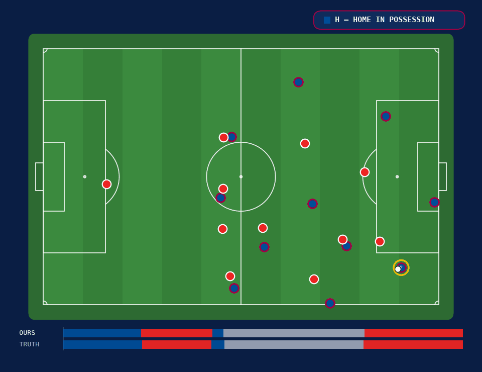

# Nootropia: More than a Hack 2027, Phase 1

Team Nootropia's entry to More than a Hack 2027 (Metrica Sports / FC Barcelona). 

We answer at each frame of BAR-ATH game if the ball is dead or alive and for alive frames which team is the owner.




The approach, training data and limitations are described in our technical document.


## Regenerate the submission
Python 3.11, CPU only.

```bash
python3.11 -m venv .venv
source .venv/bin/activate
pip install -r nootropia/requirements.txt
```

Put the provided data bundle in `data/` next to `games.py`, laid out as delivered, or point
`MTAH_DATA_DIR` at it:

```bash
export MTAH_DATA_DIR=/path/to/mtah2027
```

```bash
python nootropia/make_submission.py    # writes nootropia/outputs/nootropia.csv
```

From scratch the run takes about 4 minutes. It caches the parsed match data in
`nootropia/outputs/cache/`, so later runs take about 30 seconds; delete that folder
to rebuild from the raw files.


## Reproduce the models

The networks in `nootropia/models/` were trained on public data only: the seven matches of the DFL
open dataset (Bassek et al. 2025, CC-BY 4.0; labels from the tracking's own ball-status and
possession flags), degraded to look like automatic tracking. Every step is seeded and deterministic on CPU, and each training script prints whether the
model it writes is byte-identical to the shipped one. 

1. Download the 14 DFL files into `nootropia/outputs/ext/dfl/` (or point `DFL_DIR` at them), keeping
   their names (`DFL_02_01_matchinformation_…_DFL-MAT-<id>.xml` and
   `DFL_04_03_positions_raw_observed_…_DFL-MAT-<id>.xml`). figshare refuses scripted downloads, so
   use a browser:

   | Match | Match information | Positions |
   |---|---|---|
   | J03WMX | [51643475](https://springernature.figshare.com/ndownloader/files/51643475) | [51643514](https://springernature.figshare.com/ndownloader/files/51643514) |
   | J03WN1 | [51643472](https://springernature.figshare.com/ndownloader/files/51643472) | [51643517](https://springernature.figshare.com/ndownloader/files/51643517) |
   | J03WOH | [51643478](https://springernature.figshare.com/ndownloader/files/51643478) | [51643520](https://springernature.figshare.com/ndownloader/files/51643520) |
   | J03WOY | [51643481](https://springernature.figshare.com/ndownloader/files/51643481) | [51643523](https://springernature.figshare.com/ndownloader/files/51643523) |
   | J03WPY | [51643487](https://springernature.figshare.com/ndownloader/files/51643487) | [51643526](https://springernature.figshare.com/ndownloader/files/51643526) |
   | J03WQQ | [51643484](https://springernature.figshare.com/ndownloader/files/51643484) | [51643529](https://springernature.figshare.com/ndownloader/files/51643529) |
   | J03WR9 | [51643490](https://springernature.figshare.com/ndownloader/files/51643490) | [51643532](https://springernature.figshare.com/ndownloader/files/51643532) |

2. With the provided data bundle in place as above, run in this order:

   ```bash
   python nootropia/training/build_benchmark.py            # 7 matches x 3 noise seeds, about 50 min and 6 GB
   python nootropia/training/build_benchmark.py --boxdead  # the dead-ball model's copies (keeper holds), about 50 min
   python nootropia/training/train_ballnet.py              # 7 leave-one-out nets and the full net, about 20-35 min each
   python nootropia/training/train_dead.py                 # about 20 min
   python nootropia/training/train_players_dead.py         # about 20 min
   python nootropia/training/train_ownership.py            # about 5 min
   python nootropia/make_submission.py
   ```


## Licence

Our code, documentation and trained models are under the MIT licence: see `LICENSE`. The files
copied from Metrica Sports' repository keep their own MIT licence (`LICENSE-metrica`). The models
were trained on the DFL/IDSSE open data (Bassek et al. 2025, CC-BY 4.0), which is not included.
